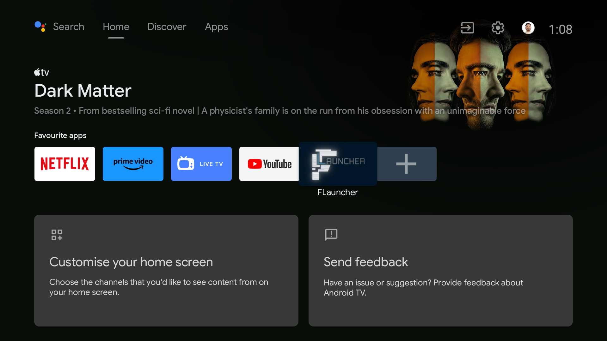
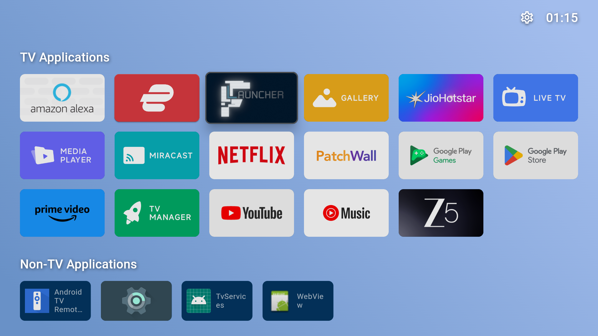
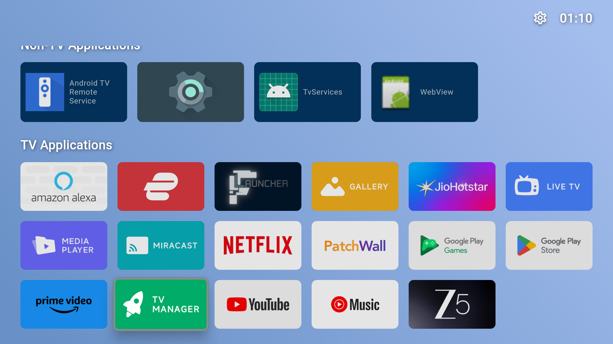

# debloat-mi-tv

Debloating a Xiaomi MiTV_MOOQ0 (MediaTek "croods/Amelie" platform) Android TV
over ADB with an AI agent: removing ad/recommendation rows, disabling unused
factory apps, and replacing the stock Google TV home screen with
[FLauncher](https://github.com/dbeley/flauncher) — all without rooting,
unlocking the bootloader, or uninstalling a single package.

The prompt used for this session is adapted from
**[tv.cobanov.dev](https://tv.cobanov.dev/)** by Mert Çobanov — a guide and
ready-to-use AI-agent prompt for safely debloating Android TVs. The full prompt
as actually run is in [tv-debloat/ORIGINAL-PROMPT.md](tv-debloat/ORIGINAL-PROMPT.md).

## Before / after

| Stock Google TV home screen (ads + "Recommended for you") | FLauncher after a full reboot |
|---|---|
|  |  |

| RAM (post-reboot) | Before | After |
|---|---|---|
| Total | 1,740,488K | 1,740,488K |
| Free | 571,039K | 589,808K |
| Used | 1,296,260K | 1,274,126K |
| Disabled packages | 0 | 32 |

## What was done

1. **Measured first** — captured `dumpsys meminfo` and `pm list packages`
   before touching anything.
2. **Disabled 32 factory/bloat packages** in small batches (≤10 at a time),
   using only `pm disable-user --user 0` — nothing was uninstalled, so every
   change is reversible with `pm enable <package>`.
3. **Found and fixed a real regression**: an early batch broke the remote's
   hardware Input/Settings/Info/Xiaomi/Channel buttons. Root-caused to a single
   package (`com.xiaomi.android.tvsetup.partnercustomizer`) by re-enabling in
   isolation and bisecting — documented in full in
   [DEBLOAT-LOG.md](tv-debloat/DEBLOAT-LOG.md).
4. **Replaced the home screen** with FLauncher. This OEM build hides the
   "default Home app" picker in Settings entirely, so it was set via ADB's
   Role Manager (`cmd role add-role-holder android.app.role.HOME
   me.efesser.flauncher`) instead of the Settings UI.
5. **Halved animation speeds** and **trimmed app caches**.
6. Verified everything survived a full reboot: FLauncher stayed as the home
   screen, no ads, and all core functionality (HDMI switching, Netflix, Prime
   Video, YouTube, sound, on-screen keyboard, hardware remote buttons)
   confirmed working.

## FLauncher, working



## Repo contents

- [tv-debloat/DEBLOAT-LOG.md](tv-debloat/DEBLOAT-LOG.md) — full batch-by-batch
  log: what was disabled, why, the regression found and fixed, and the exact
  undo command for every change.
- [tv-debloat/kapatilanlar.txt](tv-debloat/kapatilanlar.txt) — flat list of
  every disabled package.
- [tv-debloat/ORIGINAL-PROMPT.md](tv-debloat/ORIGINAL-PROMPT.md) — the prompt
  this session was run from (adapted from [tv.cobanov.dev](https://tv.cobanov.dev/)).
- [tv-debloat/undo-all.sh](tv-debloat/undo-all.sh) — one command to re-enable
  everything and restore default animation speeds.
- `tv-debloat/meminfo-*.txt`, `tv-debloat/packages-*.txt` — raw before/after
  measurements.
- `tv-debloat/images/` — screenshots from the session.

## Undo everything

```bash
adb connect <TV_IP>:5555
cd tv-debloat && bash undo-all.sh
adb reboot
```

## Rules this session followed

- Only `pm disable-user --user 0` — `pm uninstall` was forbidden.
- No rooting, no bootloader unlock, no custom ROM (avoids dropping the
  Widevine certificate from L1 to L3, which would force Netflix down to SD).
- Small batches, tested by hand between each, with an explicit rollback
  protocol when something broke.
- A written record of every change and its undo command.
